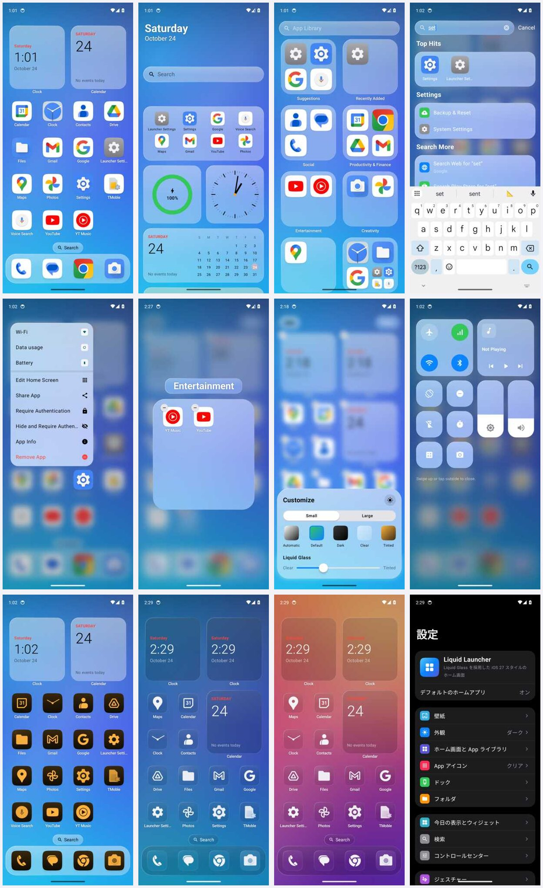

# Liquid Launcher — iOS 27 スタイルの Android ランチャー

[](https://github.com/Plpp555/liquid-OS-Android-launcher/releases/latest)
[](LICENSE)


iOS 27 のホーム画面 (Liquid Glass デザイン) を基準にした Android 向けホームアプリです。
Kotlin + Jetpack Compose で書かれており、ホーム画面の主要機能と、それを調整するための設定をひと通り備えています。
スマホ・タブレット・折りたたみスマホ (開いた画面は見開き表示) に対応しています。

> Apple Inc. とは関係のない個人プロジェクトです。iOS、Liquid Glass などは Apple Inc. の商標です。

*English summary is at the [bottom of this page](#english).*

## ダウンロードとインストール

1. [Releases](https://github.com/Plpp555/liquid-OS-Android-launcher/releases/latest) から `LiquidLauncher-<バージョン>.apk` (標準版) か
   `LiquidLauncherIsland-<バージョン>.apk` (Dynamic Island 版) をダウンロード
2. 端末で開いてインストール (「提供元不明のアプリ」の許可を求められたら、使っているブラウザやファイルアプリに許可)
3. ホームボタンを押して「Liquid Launcher」を選ぶ (または初回の案内から「デフォルトのホームアプリに設定」)

- **動作環境**: Android 6.0 以降。古い Android では一部の機能が使えません ([制限事項](#制限事項))
- **更新**: 新しいバージョンの APK をそのまま上書きインストールできます。配置や設定は残ります
- **本物の確認**: 公開版はすべて同じ非公開の鍵で署名しています。署名証明書の SHA-256 は
  `F5:CA:2C:CB:24:27:10:2C:9E:9D:E5:23:D3:8B:18:A5:E7:51:9D:84:49:AD:5D:A7:20:60:86:F8:A5:75:C6:FE` です
  (各リリースのページにも APK の SHA-256 と一緒に載せています)。ここ以外で配られている APK は入れないでください
- 開発途中のテスト版 (debug ビルド、パッケージ名 `com.aa.launcher.debug`) は Actions の「Android CI (debug)」の Artifacts にありますが、通常は Releases の版を使ってください
- **Dynamic Island 版** (`LiquidLauncherIsland-<バージョン>.apk`、v1.1.0〜): 画面上部のカメラ穴を中心に Dynamic Island を表示する版です
  (充電中・再生中の音楽、タップで弾む、再生中はタップで Liquid Glass のポップアップ。スマホのみ)。
  パッケージ名が違う (`com.aa.launcher.island`) ので標準版と並べて入れられます (配置や設定は別。移るときは設定のバックアップ/復元を使ってください)。
  再生中の音楽の表示には、その版の「通知へのアクセス」の許可が必要です。テスト版は Artifacts の `liquid-launcher-island-test-build` です

### プライバシー

インターネットへのアクセス権限を持たず、データの収集や送信は一切行いません。設定・配置・壁紙は端末内にだけ保存されます。
次の権限・機能は、使う場合だけ許可を求めます:

| 許可 | 使う機能 |
| --- | --- |
| 通知へのアクセス | 通知バッジ、コントロールセンターの再生中のメディア |
| ユーザー補助 (Liquid Launcher ジェスチャー) | ジェスチャーからの画面ロック・最近使ったアプリ・通知センター |
| システム設定の変更 | コントロールセンターの明るさ・画面の向きのロック |
| おやすみモードへのアクセス | コントロールセンターのおやすみモード |
| 連絡先 | Spotlight での連絡先検索 |



左上から: ホーム画面 / 今日の表示 / App ライブラリ / Spotlight / 長押しメニュー / フォルダ / カスタマイズ /
コントロールセンター / 色合いアイコン / ダークモード + クリアアイコン / 壁紙「サンライズ」 / 設定 (日本語・ダーク)。
(CI のエミュレータで撮影したものです)

## 主な機能

### ホーム画面
- **Liquid Glass**: ドック・フォルダ・メニュー・ウィジェットの背後の壁紙をぼかして映し込むガラス素材。縁にハイライトが入ります
- **クリア ↔ 色合い スライダー** (iOS 27): ガラスの透明度を無段階で調整できます
- iOS と同じく左上から詰めて並ぶグリッド (列 3〜7 × 行 4〜9)
- ドック (3〜6 個、ガラス / 不透明 / 透明)
- ページインジケータ、またはドック上の「検索」ボタン
- ページ切り替え効果 (スライド / 奥行き / キューブ / フェード)
- 折りたたみスマホを開いた画面では見開き表示 (今日の表示 → 1・2 ページ → 3・4 ページ → … → App ライブラリ。アイコンやウィジェットが引き伸ばされない)。タブレットは iPadOS と同じく 1 ページで、今日の表示と App ライブラリは大画面に合わせた大きさ

### 編集モード
- 空いている場所を長押しすると編集モードに入り、アイコンが揺れます
- ドラッグ & ドロップで並べ替え、ページをまたいだ移動、ドックへの出し入れ
- App を別の App に重ねるとフォルダを作成 (名前はカテゴリから自動で付きます)
- 「−」ボタンで取り除く / App を削除
- 上部の「編集」メニュー: ウィジェットを追加 / カスタマイズ / ページを編集 (ページの表示/非表示・削除)

### 触覚タッチメニュー (長押し)
- App ショートカット (クイックアクション)
- ホーム画面を編集・App を共有・App 情報・App を取り除く
- 認証を必要にする / 非表示にして認証を必要にする (iOS 18 のロック/非表示 App)
- フォルダの名称変更・ウィジェットのサイズ変更や編集

### App アイコン (iOS 18 / 26 / 27 の「カスタマイズ」相当)
- スタイル: 自動 / デフォルト / ダーク / クリア / 色合い
  - Android 13 以降のモノクロアイコンに対応
  - 色合いは色相・明るさ・壁紙の色から選択
- 大きいアイコン (名前を隠す)、サイズ調整
- 形状: スクワークル (iOS の連続曲率) / 角丸 / 円 / しずく / スクエア / オリジナル
- ADW / Nova 互換のアイコンパック

### フォルダ
- 背景をぼかして開く 3×3 (または 4 列) のページ表示
- フォルダ内での並べ替え、外へドラッグして取り出し

### App ライブラリ (右端のページ)
- 提案・最近追加した項目・カテゴリ別の自動フォルダ
- 検索と、索引付きのアルファベット (五十音) 順一覧
- 非表示の App をまとめた「非表示」フォルダ (認証付き)

### 今日の表示 (左端のページ) とウィジェット
- 内蔵ウィジェット: 時計・アナログ時計・カレンダー・バッテリー・Siri からの提案・メモ・検索 (小 / 中 / 大)
- Android のウィジェット (AppWidget) も追加可能
- ホーム画面のページにもウィジェットを配置できます

### Spotlight 検索 (ホーム画面で下にスワイプ)
- App・設定項目・連絡先・計算機・Web 検索・Play ストア検索
- Siri からの提案 (使用頻度から算出) と最近の検索
- ひらがな/カタカナ、全角/半角を区別しない検索

### コントロールセンター (右上から下にスワイプ)
- 再生中のメディア操作、通信系パネル、フラッシュライト、おやすみモード、画面の向きのロック
- 明るさ / 音量スライダー、タイマー・アラーム・計算機・カメラなど
- 表示するコントロールは設定で選べます

### ジェスチャー
- 下スワイプ / 右上から下スワイプ / 上スワイプ / ダブルタップ / ホームボタン に、
  Spotlight・通知センター・コントロールセンター・App ライブラリ・画面ロック・App を開く などを割り当て可能

## 設定アプリ

ホーム画面上の「ランチャー設定」アイコン (iOS の設定アプリ風) から開けます。

| 項目 | 内容 |
| --- | --- |
| 壁紙 | 内蔵壁紙 8 種 / 写真 (ピンチで拡大・ドラッグで移動して使う範囲を決める) / システム壁紙、ダークモードで暗くする、ホーム画面でぼかす、システムの壁紙 (ホーム/ロック) に設定 |
| 外観 | 自動/ライト/ダーク、Liquid Glass スライダー、アクセントカラー、ステータスバー |
| ホーム画面と App ライブラリ | グリッド、新しい App の追加先、今日の表示/App ライブラリ/検索ボタンの表示、レイアウトのロック、ページ切り替え効果、レイアウトのリセット |
| App アイコン | スタイル、色合い、サイズ、形状、アイコンパック、ラベル、影 |
| ドック / フォルダ | 表示、個数、スタイル、ラベル / 列数、背景ぼかし |
| 今日の表示とウィジェット | 日付表示、12/24 時間、秒表示 |
| 検索 | 提案、キーボード自動表示、最近の検索、検索対象、検索エンジン (Google / Bing / DuckDuckGo / Yahoo / Yahoo! JAPAN / Ecosia / Brave) |
| コントロールセンター | 有効/無効、表示するコントロール、必要な権限 |
| ジェスチャー | 各ジェスチャーの動作、ジェスチャーサービス (ユーザー補助) |
| 通知バッジ | 通知へのアクセス、数字/ドット/オフ、バッジの色 |
| ロック/非表示の App | App ごとのロック・非表示、非表示フォルダ/設定画面への認証 |
| アニメーションと触覚 | 速度、App を開くときのアニメーション、揺れ、触覚フィードバック、視差効果を減らす |
| アクセシビリティ | 透明度を下げる、コントラストを上げる、文字を太くする、視差効果を減らす |
| バックアップとリセット | 設定とレイアウトの書き出し/復元、設定のリセット、提案データのリセット |

英語と日本語に対応しています (端末の言語設定に従います)。

## ビルド

要件: JDK 17 以上、Android SDK (compileSdk 36)。対応 OS は **Android 6.0 以降** (minSdk 23)。

```bash
./gradlew assembleDebug      # app/build/outputs/apk/debug/
./gradlew assembleRelease    # app/build/outputs/apk/release/
```

GitHub Actions:
- `.github/workflows/android.yml` (Android CI): push のたびにビルドと lint で確認します (APK は置きません)
- `.github/workflows/android-debug.yml` (Android CI (debug)): push のたびにテスト版 (debug) を作り、Artifacts に置きます (標準版 `liquid-launcher-test-build`、Dynamic Island 版 `liquid-launcher-island-test-build`)
- 2 つの版は Gradle の product flavor (`standard` / `island`) で 1 つのコードから作ります (例: `./gradlew assembleStandardDebug`、`./gradlew assembleIslandDebug`)
- `.github/workflows/release.yml`: `v1.2.3` の形のタグを push すると、非公開の鍵で署名した APK (標準版と Dynamic Island 版) を付けて Releases に公開します

また `.github/workflows/emulator-smoke.yml` (Pull Request 時と手動実行時) では、Android エミュレータ (API 34 と、Android 6.0 の API 23) 上で実際にランチャーを起動し、
初回案内 → ホーム画面 → 今日の表示 → App ライブラリ → Spotlight → 長押しメニュー → 編集モード → コントロールセンター →
設定画面、さらにドラッグでのフォルダ作成・ウィジェット追加・ダークモード・壁紙変更・日本語表示までを操作して、
画面のテキストとクラッシュログを出力します (`.github/scripts/smoke*.sh`)。

- debug ビルドのパッケージ名は `com.aa.launcher.debug` なので、公開版と並べてインストールできます
- debug ビルド (と、公開用の鍵がないときの release ビルド) は、リポジトリ内の開発用の鍵 (`app/signing/`) で署名します。
  この鍵は公開されているので、公開版の署名には使いません
- 公開版の鍵は GitHub Secrets (`RELEASE_KEYSTORE_BASE64` / `RELEASE_KEYSTORE_PASSWORD` / `RELEASE_KEY_ALIAS` / `RELEASE_KEY_PASSWORD`) にだけあります

## 使い方

1. インストールして、ホームボタンを押したときに「Liquid Launcher」を選ぶ (または初回の案内から「デフォルトのホームアプリに設定」)
2. 通知バッジとコントロールセンターのメディア操作を使う場合は、通知へのアクセスを許可
3. 画面ロック/最近使ったアプリのジェスチャーを使う場合は、ユーザー補助で「Liquid Launcher ジェスチャー」をオン
4. 明るさ・画面の向きのロックは「システム設定の変更」、おやすみモードは「おやすみモードへのアクセス」の許可が必要です

## パフォーマンス

- Liquid Glass は位置が変わったときだけ描き直し、静止中は再計算しません。ガラスと中身は別レイヤーです
- 見えていないページや他のアプリを使っている間は、時計・バッテリー監視などの定期処理を止めます
- 操作中・アニメーション中は端末の最高リフレッシュレートを要求し、静止するとシステム既定に戻します
- アイコンや壁紙は GPU 上のビットマップで保持し、App の更新時はそのアイコンだけ作り直します

開発の詳細 (方針・仕様・履歴・既知の不具合・今後の予定) は [DEVELOPMENT_NOTES.md](DEVELOPMENT_NOTES.md) を参照してください。

## 構成

```
app/src/main/java/com/aa/launcher/
├── LauncherApp.kt / MainActivity.kt
├── core/        アプリ一覧、レイアウト (保存・グリッド配置)、アイコン描画、壁紙とぼかし、
│                通知バッジ、メディア、ウィジェットホスト、システム操作、バックアップ
├── service/     通知リスナー、ユーザー補助サービス
├── settings/    設定モデル (DataStore + JSON)、設定アプリ
└── ui/          Liquid Glass、ホーム画面、フォルダ、メニュー、App ライブラリ、
                 今日の表示/ウィジェット、Spotlight、コントロールセンター
```

## 制限事項

- Android では他のアプリから Wi-Fi・Bluetooth などを直接切り替えられないため、コントロールセンターの通信系ボタンはシステムのパネルを開きます
- Android 13 以降はシステム壁紙の画像を読み取れないことが多く、その場合ガラスの背景ぼかしは使えません。内蔵壁紙か写真を選ぶとぼかしが有効になります
- App ショートカットはデフォルトのホームアプリに設定しているときのみ表示されます
- 古い Android では一部の機能が使えません: App ショートカット (7.1 以降)、ジェスチャーからの画面ロック (9 以降)、
  ホーム画面とロック画面への別々の壁紙設定 (7.0 以降)、メニュー表示中の背後のぼかし (12 以降)。
  Android 8.0 未満ではアダプティブアイコンがないため、アイコンは従来形式のものとして描画します

## 開発への参加

不具合の報告や要望は [Issues](https://github.com/Plpp555/liquid-OS-Android-launcher/issues) へどうぞ。Pull Request も歓迎します。
進め方は [CONTRIBUTING.md](CONTRIBUTING.md)、変更履歴は [CHANGELOG.md](CHANGELOG.md)、
設計と開発の記録は [DEVELOPMENT_NOTES.md](DEVELOPMENT_NOTES.md) を参照してください。

## ライセンス

[MIT License](LICENSE)。Apple Inc. とは関係がなく、Apple Inc. の承認や支援を受けたものではありません。

## English

**Liquid Launcher** is an Android home screen app modeled on the iOS 27 home screen with its Liquid Glass design,
written in Kotlin and Jetpack Compose. It supports phones, tablets and foldables (two-page spreads on the unfolded screen)
running Android 6.0 or later. The UI is available in English and Japanese.

- **Download**: get `LiquidLauncher-<version>.apk` from [Releases](https://github.com/Plpp555/liquid-OS-Android-launcher/releases/latest),
  install it, then choose Liquid Launcher as your home app. New versions install over the old one.
  `LiquidLauncherIsland-<version>.apk` adds a Dynamic Island around the camera cutout (phones only; installs alongside the standard edition).
- **Authenticity**: every release is signed with the same private key; its certificate SHA-256 is
  `F5:CA:2C:CB:24:27:10:2C:9E:9D:E5:23:D3:8B:18:A5:E7:51:9D:84:49:AD:5D:A7:20:60:86:F8:A5:75:C6:FE`.
- **Privacy**: no internet permission and no data collection. Optional permissions (notification access,
  accessibility, write settings, Do Not Disturb access, contacts) are requested only for the features that need them.
- **License**: MIT. This is an independent project, not affiliated with or endorsed by Apple Inc.
